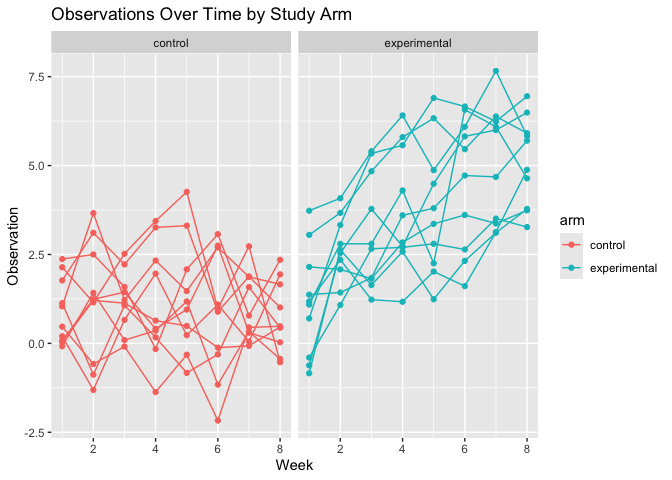
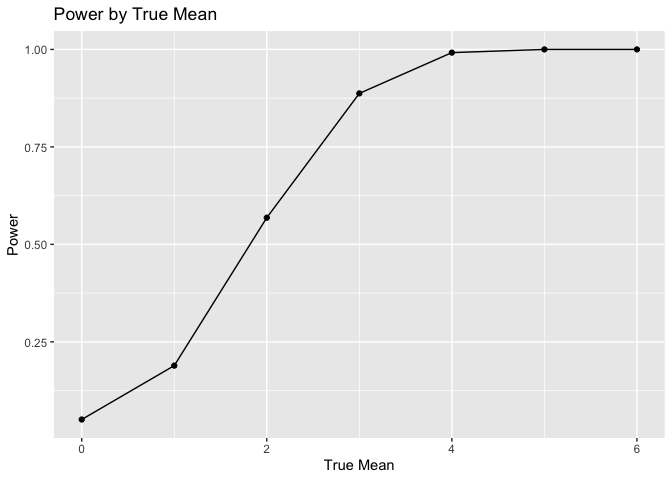
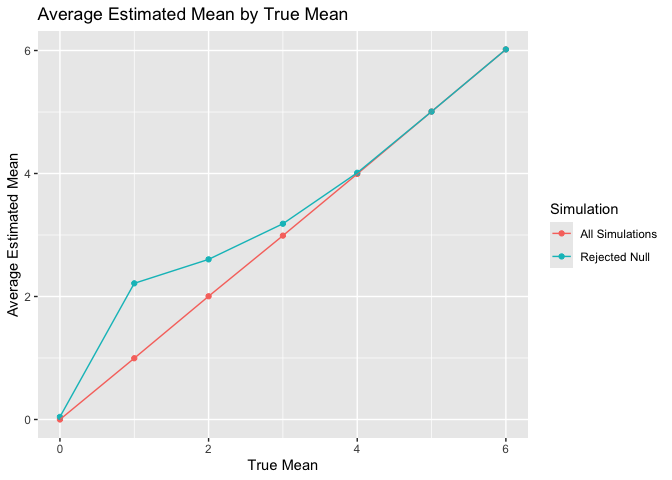

Homework 5
================
Karthika Shankar
2026-11-18

# Problem 1

``` r
set.seed(1)

birthday_sim = function(group_size) {
  birthdays = sample(1:365, group_size, replace = TRUE)
  shared_birthday = n_distinct(birthdays) < group_size
  shared_birthday
}
```

``` r
birthday_results = 
  expand_grid(
    group_size = 2:50,
    iter = 1:10000
  ) |> 
  mutate(
    shared_birthday = map_lgl(group_size, birthday_sim)
  )
```

``` r
birthday_summary = 
  birthday_results |> 
  group_by(group_size) |> 
  summarize(
    probability = mean(shared_birthday)
  )
```

``` r
birthday_summary |> 
  ggplot(aes(x = group_size, y = probability)) +
  geom_point() +
  geom_line() +
  labs(
    title = "Probability of a Shared Birthday by Group Size",
    x = "Group Size",
    y = "Probability of a Shared Birthday"
  )
```

<!-- -->

The probability that at least two people share a birthday increases as
the group size increases. The probability is low for small groups but
reaches about 50% when the group size is around 23 people. As the group
size continues to increase the probability of a shared birthday
approaches 1.

# Problem 2

``` r
study_df = 
  tibble(
    files = list.files("data/"),
    path = str_c("data/", files)
  ) |> 
  mutate(
    data = map(path, read_csv)
  )
```

``` r
study_df = 
  study_df |> 
  unnest(cols = "data")
```

``` r
study_tidy = 
  study_df |> 
  mutate(
    files = str_replace(files, ".csv", "")
  ) |> 
  separate(
    files,
    into = c("arm", "subject_id"),
    sep = "_"
  ) |> 
  mutate(
    arm = str_replace(arm, "con", "control"),
    arm = str_replace(arm, "exp", "experimental")
  ) |> 
  pivot_longer(
    week_1:week_8,
    names_to = "week",
    values_to = "observation",
    names_prefix = "week_"
  ) |> 
  mutate(
    week = as.numeric(week)
  ) |> 
  select(arm, subject_id, week, observation)
```

``` r
study_tidy |> 
  ggplot(aes(x = week, y = observation, group = subject_id, color = arm)) +
  geom_point() +
  geom_path() +
  facet_grid(~arm) +
  labs(
    title = "Observations Over Time by Study Arm",
    x = "Week",
    y = "Observation"
  )
```

<!-- -->

The control group shows relatively little change in observations over
time and the values fluctuate around a similar range for the eight
weeks. The experimental group generally shows an upward trend and the
observations increase as the study progresses. This suggests that the
experimental treatment might be associated with an increase in the
measured outcome over time.

# Problem 3

``` r
set.seed(1)

sim_ttest = function(mu) {
  sim_data = 
    tibble(
      x = rnorm(30, mean = mu, sd = 5)
    )
  
  t.test(sim_data |> pull(x), mu = 0) |> 
    broom::tidy() |> 
    select(estimate, p.value)
}
```

``` r
sim_results = 
  expand_grid(
    mu = 0:6,
    iter = 1:5000
  ) |> 
  mutate(
    results = map(mu, sim_ttest)
  ) |> 
  unnest(results)
```

``` r
power_results = 
  sim_results |> 
  mutate(
    reject = p.value < 0.05
  ) |> 
  group_by(mu) |> 
  summarize(
    power = mean(reject)
  )
```

``` r
power_results |> 
  ggplot(aes(x = mu, y = power)) +
  geom_point() +
  geom_line() +
  labs(
    title = "Power by True Mean",
    x = "True Mean",
    y = "Power"
  )
```

<!-- -->

As the true mean increases, power also increases. When the true mean is
close to 0, the null hypothesis is rejected less often. As the true mean
moves farther from 0, the null hypothesis is rejected more often, and
power approaches 1.

``` r
mean_results = 
  sim_results |> 
  group_by(mu) |> 
  summarize(
    mean_estimate = mean(estimate)
  )

rejected_results = 
  sim_results |> 
  filter(p.value < 0.05) |> 
  group_by(mu) |> 
  summarize(
    mean_estimate = mean(estimate)
  )
```

``` r
estimate_results = 
  bind_rows(
    mean_results |> 
      mutate(type = "All Simulations"),
    rejected_results |> 
      mutate(type = "Rejected Null")
  )
```

``` r
estimate_results |> 
  ggplot(aes(x = mu, y = mean_estimate, color = type)) +
  geom_point() +
  geom_line() +
  labs(
    title = "Average Estimated Mean by True Mean",
    x = "True Mean",
    y = "Average Estimated Mean",
    color = "Simulation"
  )
```

<!-- -->

Across all simulations, the estimates are centered around the true mean
so on average we get the right answer. Among simulations where the null
hypothesis is rejected, the average estimate is not approximately equal
to the true mean for smaller positive values of the true mean. When the
power is small samples with larger estimated effects are more likely to
reject the null which leads to overestimation. As power increases this
overestimation becomes smaller and the average estimate among rejected
simulations gets closer to the true mean.
